<div align="center">


# Duri

**A dynamic island for Windows.**

Music, Claude Code sessions, your clipboard, notes and timers in a small pill at the top of the screen.
It shows what's going on, opens on hover and expands on click.

[](https://github.com/yushadev0/duri/releases/latest)
[](https://github.com/yushadev0/duri/actions/workflows/ci.yml)
[](LICENSE)


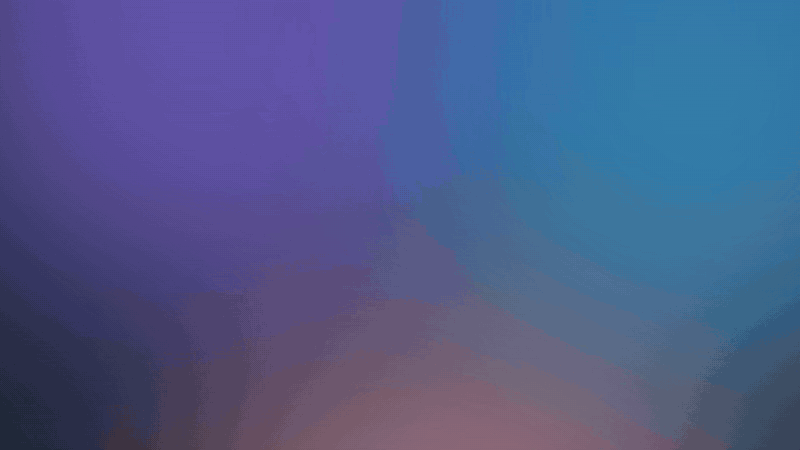

</div>

## Install

1. Download **`Duri_x.y.z_x64-setup.exe`** from the [latest release](https://github.com/yushadev0/duri/releases/latest).
2. Run it. Windows SmartScreen may warn that the publisher is unknown, because the installer isn't code-signed yet: choose **More info › Run anyway**.
3. Duri appears at the top of your screen. Right-click it or its tray icon for Settings.

Duri updates itself: it checks GitHub for new versions and tells you, and you install with one click in **Settings › About**. Nothing installs without you.

## Apps

Duri's features are called **apps**. Each one can be switched off in Settings › Apps.

<table>
  <tr>
    <td width="50%">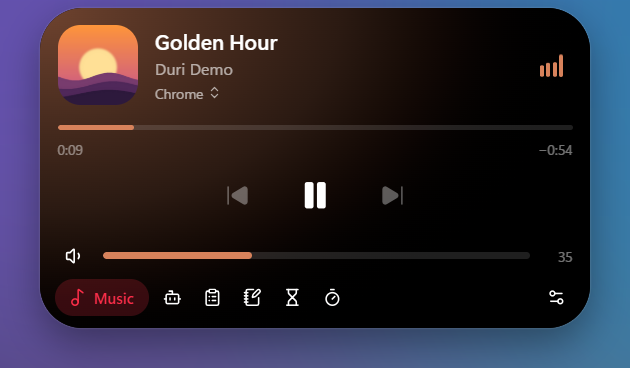</td>
    <td width="50%">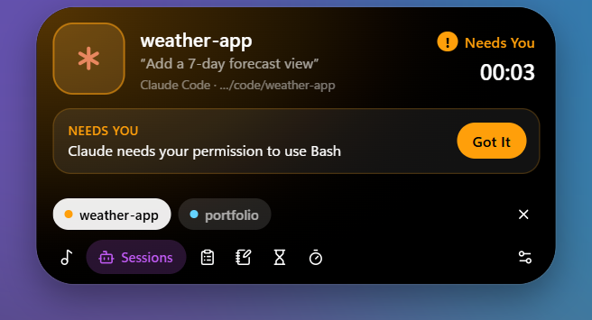</td>
  </tr>
  <tr>
    <td><b>🎵 Music.</b> What's playing in Spotify, your browser or any media app, tinted with the cover's color. Play, pause, skip, seek, set the volume and switch players.</td>
    <td><b>🤖 Sessions.</b> Follows your Claude Code and Codex sessions: working, needs you, done. When Claude asks for permission, the island opens and tells you which project, and can answer it for you: Allow or Deny right from the island (opt-in, Settings › Apps).</td>
  </tr>
  <tr>
    <td>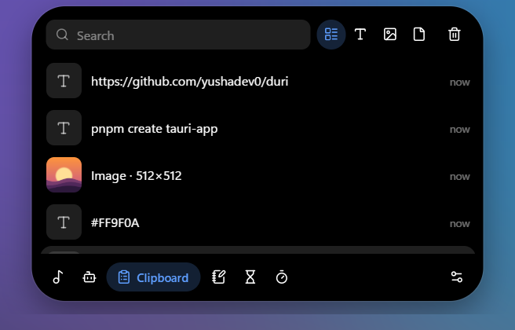</td>
    <td>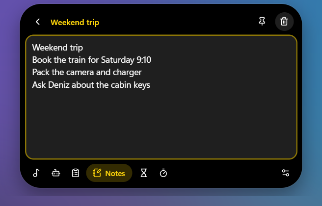</td>
  </tr>
  <tr>
    <td><b>📋 Clipboard.</b> History of text, images and files. Search, pin, and click an item to paste it where you were typing. Skips what password managers mark as private.</td>
    <td><b>📝 Notes.</b> Quick plain-text notes, saved as you type. Search and pin them.</td>
  </tr>
  <tr>
    <td>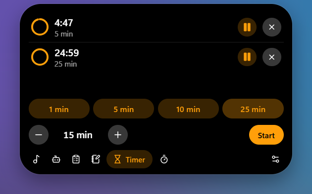</td>
    <td>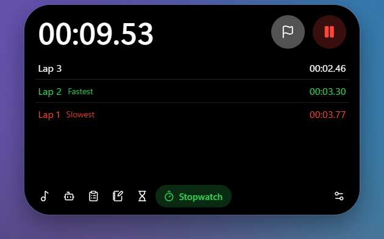</td>
  </tr>
  <tr>
    <td><b>⏳ Timer.</b> Several countdowns at once. When one ends, the island bounces open with a sound and a notification.</td>
    <td><b>⏱️ Stopwatch.</b> Laps with the fastest and slowest marked. Keeps running across restarts.</td>
  </tr>
</table>

**🔊 Volume.** The pill shows the level when the volume changes, and can replace the Windows volume popup.

<p>
  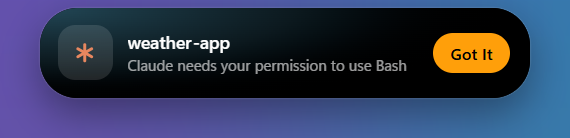
  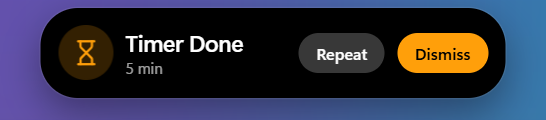
  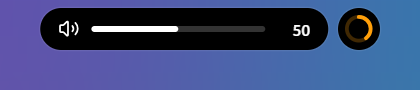
</p>

## How it behaves

- **Idle:** a pill with the most important live activity, and a small bubble for the next one. With nothing going on it shows the time, CPU and RAM usage, or both.
- **Hover:** a compact view of that activity.
- **Click:** the full app, with a dock to switch apps.
- Clicks on the empty space around the island go to the windows underneath, and it never takes focus from what you're typing in.
- It hides while a fullscreen app, game or video is in front.
- Drag it up to tuck it away into a small handle at the top edge. Hover the handle to peek; drag it down (or right-click) to bring it back.

## Performance

Duri is meant to sit there all day, so it stays out of the way. Measured on an Intel Core i5-11400H (12 threads) with Windows 11, 60 seconds per state, island resting:

| While… | CPU (one core) | CPU (whole PC) | Memory |
| --- | --- | --- | --- |
| nothing is playing | 0.6% | 0.05% | 119 MB |
| music is playing | 2.3% | 0.19% | 129 MB |
| a Claude Code session is working | 1.4% | 0.12% | 126 MB |

CPU is the time used by Duri and its WebView2 processes; memory is the private working set, as Task Manager shows it. Most of the memory is WebView2 itself. Up to 0.1.1 the animated pill kept the island repainting at the display's refresh rate and used up to 20% of a core while music played; it now changes a few times a second. Measure it yourself with `powershell -ExecutionPolicy Bypass -File scriptsench.ps1`.

## Settings

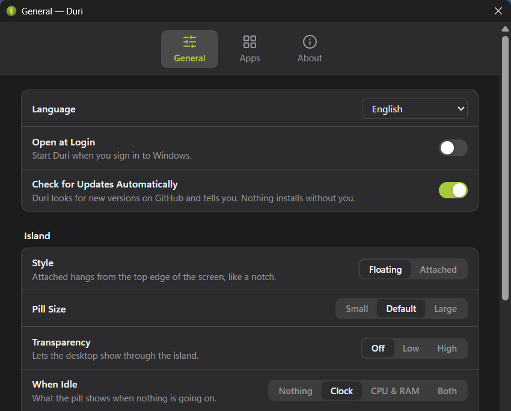

Style (floating, or attached to the top edge like a notch), pill size, transparency, what the idle pill shows, 12/24-hour clock, hide in fullscreen, replace the Windows volume popup, open at login, automatic update checks, and English or Turkish.

## Build from source

Requirements: Windows 10/11, [Node.js](https://nodejs.org) 20+, [pnpm](https://pnpm.io), [Rust](https://rustup.rs) (MSVC toolchain) and the Visual Studio C++ Build Tools.

```powershell
pnpm install
pnpm tauri dev      # run in development
pnpm tauri build    # build the installers into src-tauri/target/release/bundle
```

[Tauri 2](https://tauri.app) (Rust) with a React + TypeScript UI and [Motion](https://motion.dev) for the springs. Media control uses Windows' Global System Media Transport Controls; data lives in SQLite under `%APPDATA%\Duri`. See [docs/ARCHITECTURE.md](docs/ARCHITECTURE.md).

## Contributing

Ideas and pull requests are welcome. Start with [CONTRIBUTING.md](CONTRIBUTING.md) and [docs/ADDING_AN_APP.md](docs/ADDING_AN_APP.md). The name comes from the durian: spiky outside, soft inside.

## Türkçe

Duri, Windows için bir dinamik ada. Ekranın üstünde küçük bir hap olarak durur: o an olanı gösterir, üzerine gelince açılır, tıklayınca büyür. İçinde Müzik, Claude Code ve Codex oturum takibi, Pano geçmişi, Notlar, Zamanlayıcı, Kronometre ve ses göstergesi var. Tam ekran bir uygulama ya da video açıkken kendini gizler, yeni sürümleri kendisi bulur. Arayüz Türkçe ve İngilizce.

Kurmak için [son sürümden](https://github.com/yushadev0/duri/releases/latest) `Duri_x.y.z_x64-setup.exe` dosyasını indirip çalıştır. SmartScreen uyarırsa **Ek bilgi › Yine de çalıştır**'ı seç.

## License

[MIT](LICENSE). The demo video and screenshots use generated content only (music, cover art, sessions, clips and notes).
