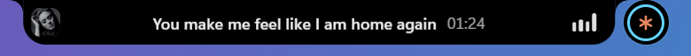
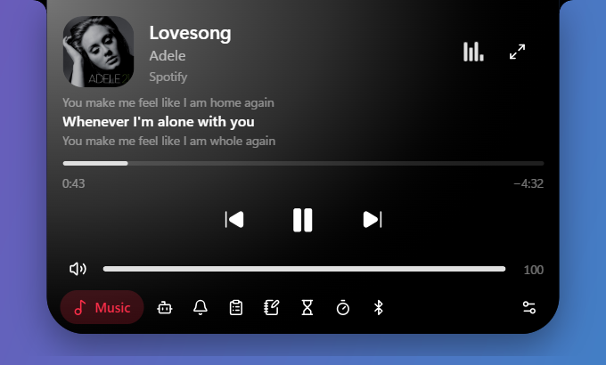
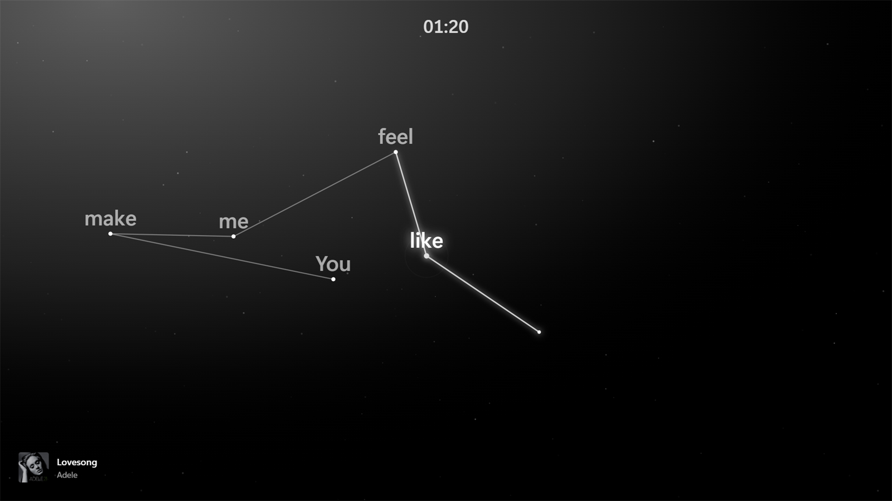
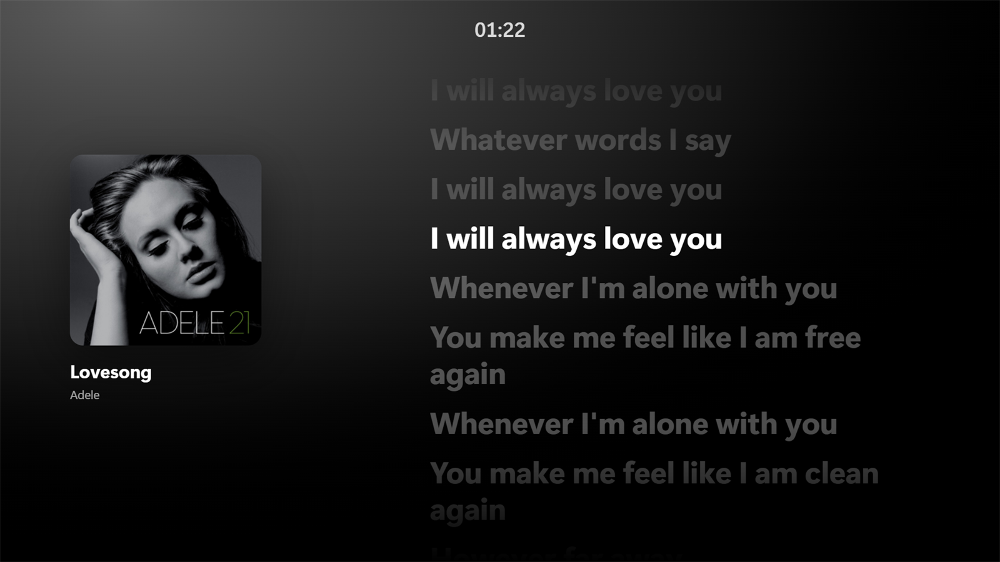
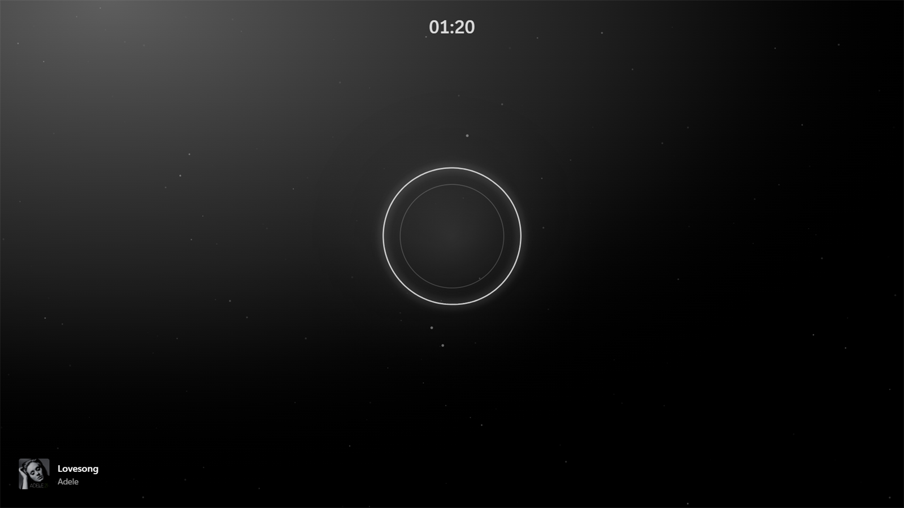
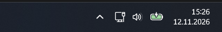
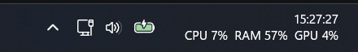
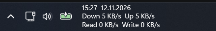
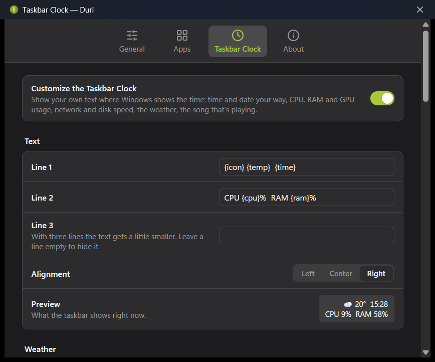
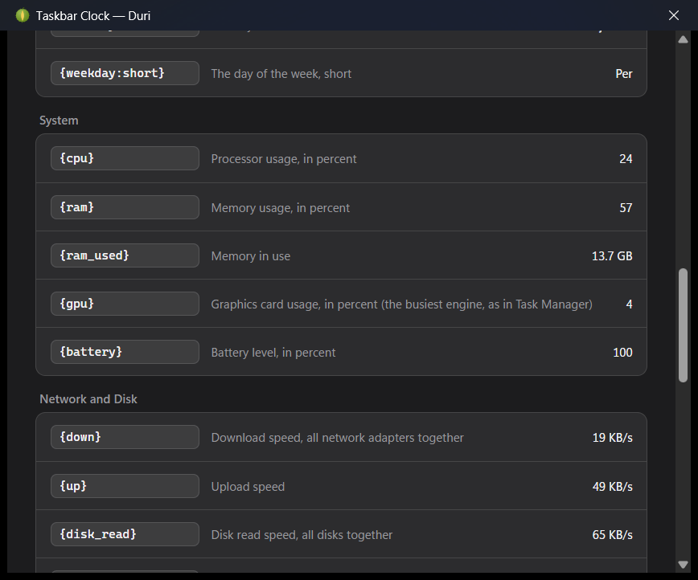

<div align="center">


# Duri

**A dynamic island for Windows.**

Music, Claude Code sessions, your clipboard, notes and timers in a small pill at the top of the screen.
It shows what's going on, opens on hover and expands on click.

[](https://github.com/yushadev0/duri/releases/latest)
[](https://github.com/yushadev0/duri/actions/workflows/ci.yml)
[](LICENSE)


</div>

## Install

1. Download **`Duri_x.y.z_x64-setup.exe`** from the [latest release](https://github.com/yushadev0/duri/releases/latest).
2. Run it. Windows SmartScreen may warn that the publisher is unknown, because the installer isn't code-signed yet: choose **More info › Run anyway**.
3. Duri appears at the top of your screen. Right-click it or its tray icon for Settings.

Duri updates itself: it checks GitHub for new versions and tells you, and you install with one click in **Settings › About**. Nothing installs without you.

## Apps

Duri's features are called **apps**. Each one can be switched off in Settings › Apps.

<table>
  <tr>
    <td width="50%"></td>
    <td width="50%"></td>
  </tr>
  <tr>
    <td><b>🎵 Music.</b> What's playing in Spotify, your browser or any media app, tinted with the cover's color. Play, pause, skip, seek, set the volume and switch players, and sing along: <a href="#lyrics-and-idle-mode">lyrics and a fullscreen Idle Mode</a>.</td>
    <td><b>🤖 Sessions.</b> Follows your Claude Code and Codex sessions: working, needs you, done. When Claude asks for permission, the island opens and tells you which project, and can answer it for you: Allow or Deny right from the island (opt-in, Settings › Apps).</td>
  </tr>
  <tr>
    <td></td>
    <td></td>
  </tr>
  <tr>
    <td><b>📋 Clipboard.</b> History of text, images and files. Search, pin, and click an item to paste it where you were typing. Skips what password managers mark as private.</td>
    <td><b>📝 Notes.</b> Quick plain-text notes, saved as you type. Search and pin them.</td>
  </tr>
  <tr>
    <td></td>
    <td></td>
  </tr>
  <tr>
    <td><b>⏳ Timer.</b> Several countdowns at once. When one ends, the island bounces open with a sound and a notification.</td>
    <td><b>⏱️ Stopwatch.</b> Laps with the fastest and slowest marked. Keeps running across restarts.</td>
  </tr>
</table>

**🔔 Notifications.** Windows notifications show up in the pill as they arrive, and the island keeps the recent ones (in memory only). Dismissing one there removes it from Action Center too. Copying something shows a short "Copied" confirmation.

**🔊 Volume.** The pill shows the level when the volume changes, and can replace the Windows volume popup. It shows even over fullscreen apps and while the island is hidden.

**⌨️ Lock keys.** Caps Lock, Insert and Scroll Lock show whether they're on or off when you press them, next to the volume indicator.

**🎧 Bluetooth.** The battery level of every connected Bluetooth device, as rings in the dock app, a notice when one runs low (20%), and a short notice when one connects or disconnects.

**🔋 Battery.** A short notice when you plug the charger in or out, and a warning when the laptop battery runs low (20%, and again at 10%, which keeps the island open).

**☀️ Brightness.** The pill shows the screen brightness when it changes, with a slider on hover. Built-in laptop screens only.

**🎥 Camera and microphone.** A green camera or orange microphone badge beside the island while an app uses them, and a short notice naming the app that started. Each one can be turned off in Settings.

<p>
  
  
  
</p>

## Lyrics and Idle Mode

Music follows the lyrics of the song that's playing, in any player. They come from [LRCLIB](https://lrclib.net), an open lyrics library: word by word when LRCLIB has the timing for each word, line by line otherwise.

<p align="center">
  
</p>

<table>
  <tr>
    <td width="50%"></td>
    <td>
      <ul>
        <li><b>In the Music app</b>, three lines sit between the song and the controls: the one before, the one being sung, and the next.</li>
        <li><b>In the pill</b> (Settings › Apps › Music), the line being sung, on one line, with the time beside it if you like. The pill widens for it, and music keeps the pill while a Claude Code session works, which moves to the bubble.</li>
        <li><b>Idle Mode</b>: the ⤢ button opens the song full screen, for when the music plays and you step away.</li>
      </ul>
    </td>
  </tr>
</table>



<table>
  <tr>
    <td width="50%"></td>
    <td width="50%"></td>
  </tr>
</table>

Idle Mode has three looks, switched at the top or with the 1, 2 and 3 keys:

- **Network.** Every line becomes a small constellation: each word lands at a random spot as it's sung, a line reaches it from the word before, and when the line is over the figure fades and the next one starts on an empty sky. Where nothing is sung (the intro, a break, an instrumental) a circle breathes with the music instead.
- **Lyrics.** The cover beside the lyrics, the current line bright and centered. Click a line to jump there.
- **Cover.** Just the cover, the song and its progress.

Nothing flashes, and with Windows' "Animation effects" turned off, Idle Mode starts in Lyrics and drops the moving effects. An optional clock sits at the top. Esc closes it, Space plays or pauses.

To find the lyrics, the song's title, artist, album and length are sent to LRCLIB, only while lyrics are on screen (the Music app open, Idle Mode, or the pill with lyrics turned on). Answers are kept in Duri's database, so a song is looked up once. The circle reads only the loudness of what your speakers play, the number the Windows volume mixer shows; no sound is recorded.

## How it behaves

- **Idle:** a pill with the most important live activity, and a small bubble for the next one. With nothing going on it shows the time, CPU and RAM usage, or both.
- **Hover:** a compact view of that activity.
- **Click:** the full app, with a dock to switch apps.
- Clicks on the empty space around the island go to the windows underneath, and it never takes focus from what you're typing in.
- It hides while a fullscreen app, game or video is in front.
- Keyboard: Ctrl+Alt+Space opens the island and Esc closes it. Shortcuts for a new note and for searching the clipboard can be set in Settings › General.
- Drag it up to tuck it away into a small handle at the top edge. Hover the handle to peek; drag it down (or right-click) to bring it back.
- Or let it hide itself, like an auto-hiding taskbar: it stays out of sight until the pointer reaches the top of the screen (Settings › General).
- Every app opens at the same size, so the dock stays in place while you switch between them.

## Taskbar clock (optional)

Duri can also replace the text of the Windows clock in the taskbar corner with up to three lines of your own, aligned left, center or right. Turn it on in Settings › Taskbar Clock, which lists every value below with a live example; click one to add it to a line.

<table>
  <tr>
    <td width="50%"><br />The Windows clock, as it comes</td>
    <td width="50%"><br /><code>{time:HH:mm:ss}</code><br /><code>CPU {cpu}%  RAM {ram}%  GPU {gpu}%</code></td>
  </tr>
  <tr>
    <td><br /><code>{icon} {temp}  {weather}</code><br /><code>{city}  H {high}  L {low}</code>, centered</td>
    <td><br /><code>{time}  {date:dd.MM.yyyy}</code><br /><code>Down {down}  Up {up}</code><br /><code>Read {disk_read}  Write {disk_write}</code>, left</td>
  </tr>
</table>

| Write | Get |
| --- | --- |
| `{time}`, `{date}` | the time and date as Windows formats them |
| `{time:HH:mm:ss}`, `{date:ddd d MMM}` | your own format ([format pictures](https://learn.microsoft.com/windows/win32/intl/day--month--year--and-era-format-pictures)) |
| `{weekday}`, `{weekday:short}` | the day of the week |
| `{cpu}`, `{ram}`, `{gpu}`, `{battery}` | usage and battery in percent; `{ram_used}` in GB |
| `{down}`, `{up}`, `{disk_read}`, `{disk_write}` | network and disk speed |
| `{temp}`, `{feels}`, `{icon}`, `{weather}`, `{high}`, `{low}`, `{rain}`, `{humidity}`, `{wind}`, `{city}` | the weather in the city you pick |
| `{forecast}`, `{forecast:7}` | the next 3 (or 1 – 7) days |
| `{song}`, `{artist}` | what's playing |

Values update every second; only the ones your lines use are measured. Weather comes from [Open-Meteo](https://open-meteo.com) (no account), refreshed every 15 minutes; the only thing sent is the location of the city you picked, and nothing at all while your lines have no weather in them. The taskbar makes room for whatever you write, and clicking the clock still opens the notification center.

<p>
  
  
</p>

**Read this before turning it on.** Windows has no supported way to change that clock, so this is the one feature where Duri runs code inside another program:

- Duri loads a small helper (`duri_clock.dll`, source in [`src-clock`](src-clock)) into Windows Explorer (`explorer.exe`). It is off until you turn it on, and Settings asks every time.
- It hooks no functions and patches nothing. It finds the clock's text in the taskbar's own UI tree, hides it, and puts its own text beside it. If a Windows update changes the taskbar so the clock can't be found, the normal clock simply stays.
- A bug in the helper could still crash Explorer. Windows restarts it by itself; if that happens twice right after Duri loaded the helper, Duri turns the feature off.
- Some antivirus tools flag any program that loads code into Explorer. Duri's installer is not code-signed, which makes that more likely.
- Turning it off, or quitting Duri, brings the Windows clock back within a couple of seconds. The helper itself stays loaded, doing nothing, until Explorer restarts (sign out, or restart Explorer from Task Manager).
- Windows 11 only, on the 64-bit taskbar Windows ships with. Taskbar replacements are not supported.

## Performance

Duri is meant to sit there all day, so it stays out of the way. Measured on an Intel Core i5-11400H (12 threads) with Windows 11, 60 seconds per state, island resting:

| While… | CPU (one core) | CPU (whole PC) | Memory |
| --- | --- | --- | --- |
| nothing is playing | 0.4% | 0.03% | 134 MB |
| music is playing | 1.9% | 0.16% | 135 MB |
| a Claude Code session is working | 1.5% | 0.13% | 141 MB |

CPU is the time used by Duri and its WebView2 processes; memory is the private working set, as Task Manager shows it. Most of the memory is WebView2 itself. Up to 0.1.1 the animated pill kept the island repainting at the display's refresh rate and used up to 20% of a core while music played; it now changes a few times a second. Measure it yourself with `powershell -ExecutionPolicy Bypass -File scripts\bench.ps1`.

## Settings


Style (floating, or attached to the top edge like a notch), pill size, transparency, auto-hide, what the idle pill shows, 12/24-hour clock, hide in fullscreen, keyboard shortcuts, open at login, automatic update checks, and English or Turkish. Apps can be turned off one by one (with options such as replacing the Windows volume popup, lyrics in the pill, or a clock in Idle Mode), and the taskbar clock has a tab of its own.

## Build from source

Requirements: Windows 10/11, [Node.js](https://nodejs.org) 20+, [pnpm](https://pnpm.io), [Rust](https://rustup.rs) (MSVC toolchain) and the Visual Studio C++ Build Tools with a Windows 10/11 SDK (the taskbar clock helper is C++/WinRT, built by `cargo` along with the rest).

```powershell
pnpm install
pnpm tauri dev      # run in development
pnpm tauri build    # build the installers into src-tauri/target/release/bundle
```

[Tauri 2](https://tauri.app) (Rust) with a React + TypeScript UI and [Motion](https://motion.dev) for the springs. Media control uses Windows' Global System Media Transport Controls; data lives in SQLite under `%APPDATA%\Duri`. See [docs/ARCHITECTURE.md](docs/ARCHITECTURE.md).

## Contributing

Ideas and pull requests are welcome. Start with [CONTRIBUTING.md](CONTRIBUTING.md) and [docs/ADDING_AN_APP.md](docs/ADDING_AN_APP.md). The name comes from the durian: spiky outside, soft inside.

## Türkçe

Duri, Windows için bir dinamik ada. Ekranın üstünde küçük bir hap olarak durur: o an olanı gösterir, üzerine gelince açılır, tıklayınca büyür. İçinde Müzik (şarkı sözleriyle: çalan şarkının sözleri müzik uygulamasında, istersen hapta, ve şarkıyı tam ekranda gösteren Bekleme Modu'nda), Claude Code ve Codex oturum takibi, Pano geçmişi, Notlar, Zamanlayıcı, Kronometre ve ses göstergesi var. İstersen görev çubuğundaki Windows saatinin yerine üç satıra kadar kendi yazını, istediğin biçimde saat ve tarihi, CPU, RAM, GPU, ağ ve disk kullanımını, hava durumunu ve çalan şarkıyı da gösterir; bu özellik Windows Gezgini'ne küçük bir yardımcı yüklediği için varsayılan olarak kapalıdır (ayrıntılar yukarıda, "Taskbar clock" başlığında). Tam ekran bir uygulama ya da video açıkken kendini gizler, yeni sürümleri kendisi bulur. Arayüz Türkçe ve İngilizce.

Kurmak için [son sürümden](https://github.com/yushadev0/duri/releases/latest) `Duri_x.y.z_x64-setup.exe` dosyasını indirip çalıştır. SmartScreen uyarırsa **Ek bilgi › Yine de çalıştır**'ı seç.

## License

[MIT](LICENSE). The demo video and the app screenshots use generated content (music, cover art, sessions, clips and notes). The lyrics screenshots show "Lovesong" by Adele, from the album *21*, with lyrics from LRCLIB; the song, cover and lyrics belong to their owners.
